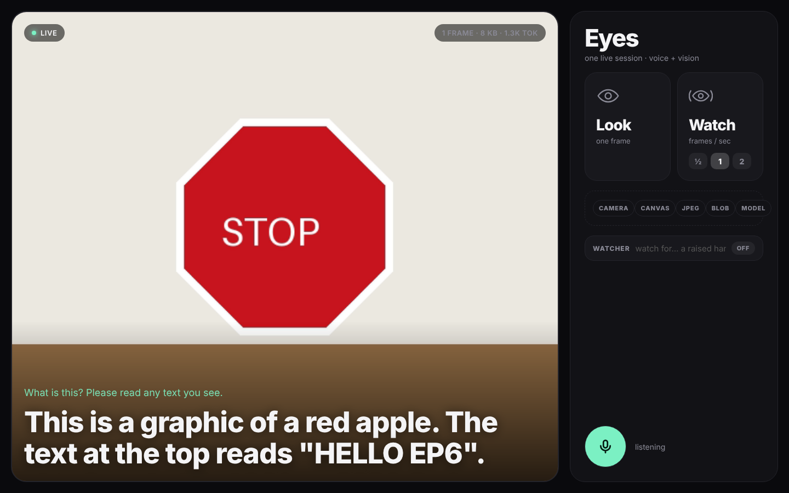
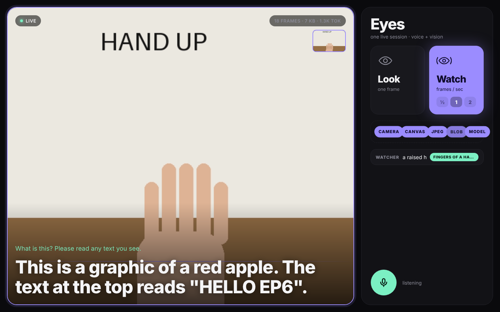

# Eyes · EP6 — Give your AI agent eyes



A minimal **ADK + Gemini Live** demo: one live session that hears your voice
*and* sees your camera.

```
camera → canvas → JPEG → Blob → model
mic    → PCM           → Blob → model
```

Same session. Same model. Different kinds of input.

## What the UI shows

| Button | Pattern | When |
|---|---|---|
| **Look** (or `Space`) | snapshot — one deliberate frame | the scene is static: an outfit, a document, a label |
| **Watch** | stream — frames at ½ / 1 / 2 fps | the world changes on its own |
| **Watcher** | a *separate* vision model scans frames for one thing and only speaks up when it sees it | hazards, gestures, state changes |

The pipeline strip lights up `Camera → Canvas → JPEG → Blob → Model` every
time a frame is sent, and the stat pill counts frames, bytes and tokens.
Frames are not free.

## Run

```bash
cp .env.example .env        # add your GOOGLE_API_KEY
pip install -r requirements.txt
python main.py
```

Open <http://localhost:8000>, tap the mic, hold something up and ask
*“what is this?”*

The moment the mic hears you start talking, the app takes one snapshot on its
own (hint reads *heard you → looked*), so “this” always means what is in
front of the camera *as you ask* — not whatever you last pressed **Look** at.
The thumbnail in the viewfinder is the exact JPEG the model received; it stays
up until the answer lands so you can compare the two. **Look** is still there
for a deliberate frame without speaking.

> Camera and mic need a secure context. `localhost` is fine. To demo from a
> phone, tunnel with `ngrok http 8000` (or similar) and open the https URL.

## Model

Default is `gemini-3.8-live` (set `LIVE_MODEL` in `.env`). To see which live
models your key can use:

```bash
python -c "from google import genai; [print(m.name) for m in genai.Client().models.list() if 'bidiGenerateContent' in (m.supported_actions or [])]"
```

## End-to-end test without a real camera

`tests/` drives the real app with a **moving** fake camera (a 20 s clip:
apple → sliding banana → rising hand → STOP sign) and a fake mic that
*speaks* "What is this? Please read any text you see."

```bash
python tests/make_fixtures.py     # needs ffmpeg + GOOGLE_API_KEY (Gemini TTS)
python main.py &
node tests/e2e.js                 # needs playwright + chromium
```

Verified run: snapshot during the apple scene → *"This is a graphic of a red
apple. The text at the top reads 'HELLO EP6'."* Watch mode at 1 fps with the
watcher set to *a raised hand* → watcher fires during the hand scene and the
talking agent mentions it.



## Files

```
main.py                  FastAPI + WebSocket bridge  ⇄  ADK run_live
vision_agent/agent.py    the agent (nothing vision-specific here)
vision_agent/watcher.py  advanced pattern: separate vision model as a watcher
static/app.js            camera → canvas → JPEG → Blob, snapshot vs stream
static/pcm-recorder.js   mic → 16 kHz PCM16
static/pcm-player.js     24 kHz PCM16 → speakers
tests/                   fake camera + fake mic end-to-end test
```

## The one idea

An image is just bytes + a mime type — a `Blob`. The live request queue that
takes audio takes images too:

```python
queue.send_realtime(types.Blob(data=jpeg_bytes, mime_type="image/jpeg"))
```

Snapshot when the agent needs to **look**. Stream when it needs to **watch**.
If the voice session starts to feel unstable, you are sending too many frames.
